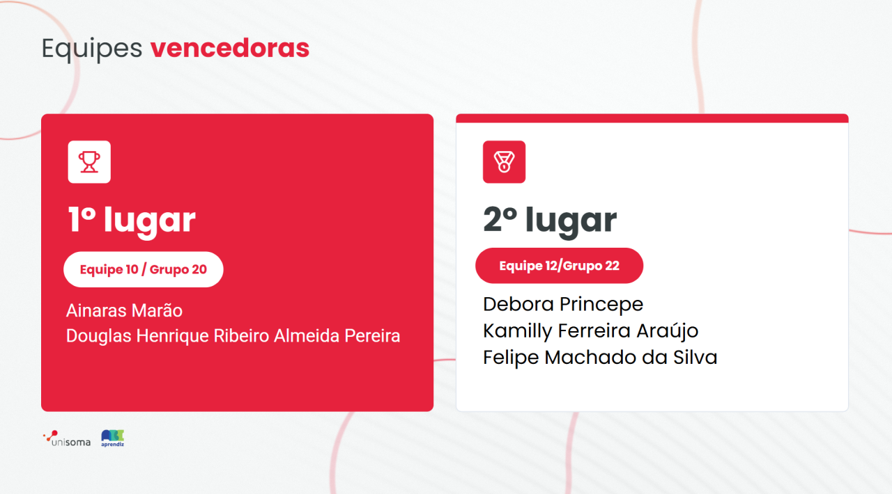
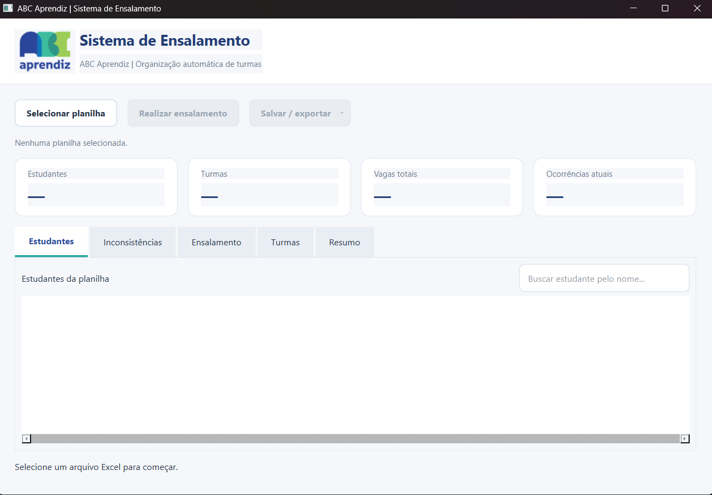
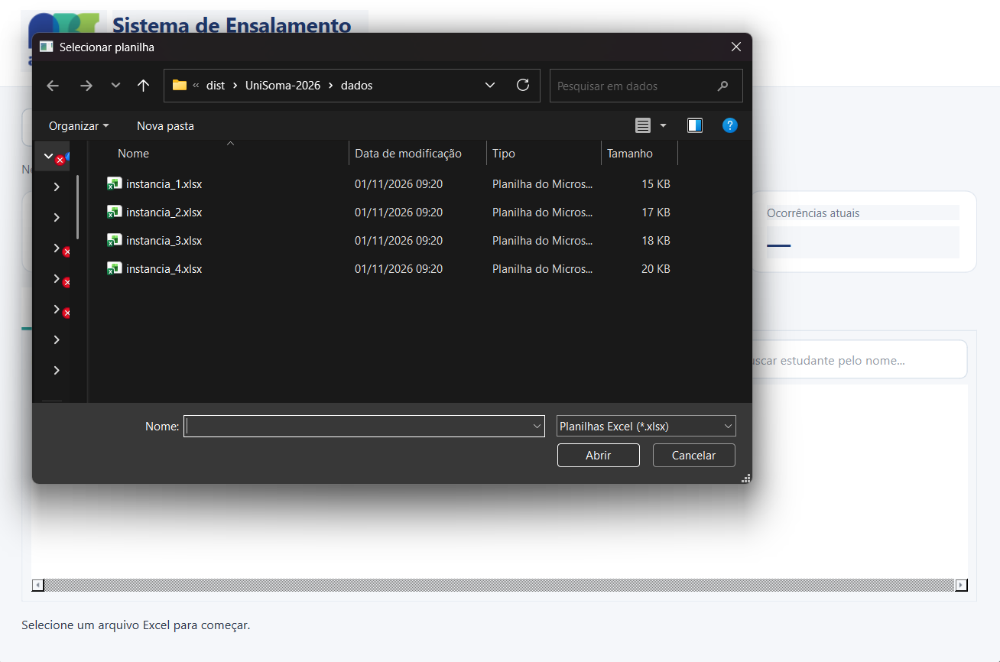
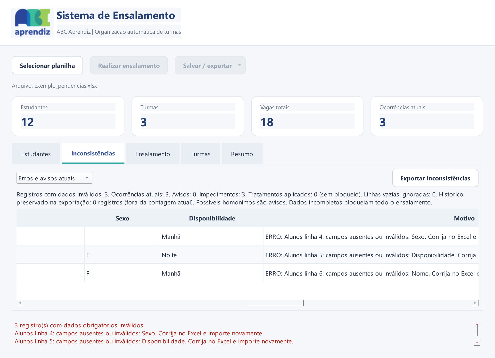
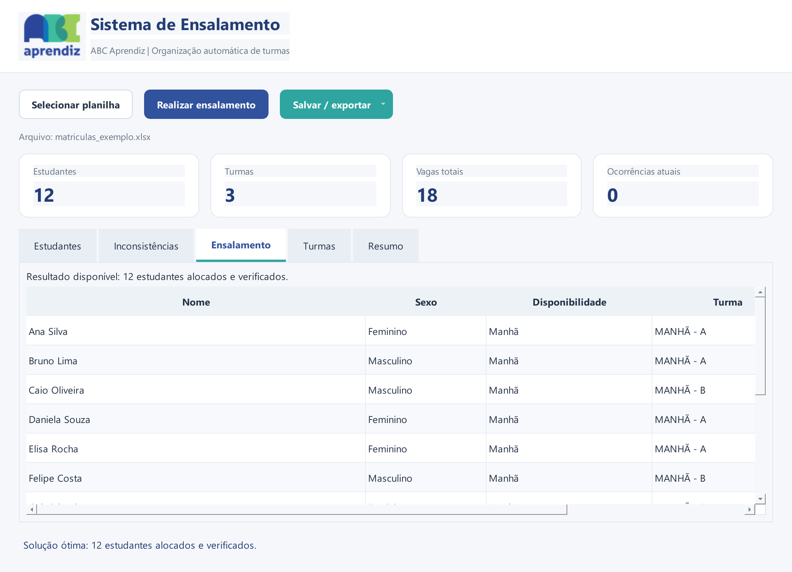
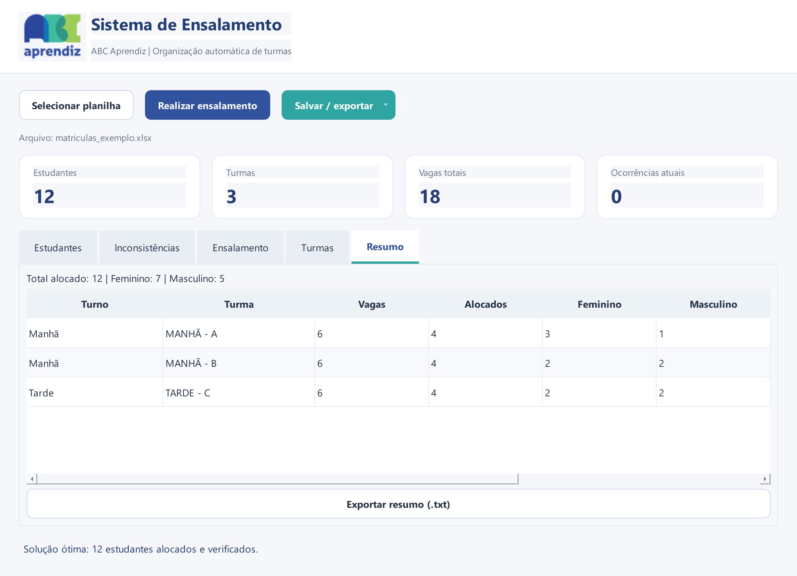
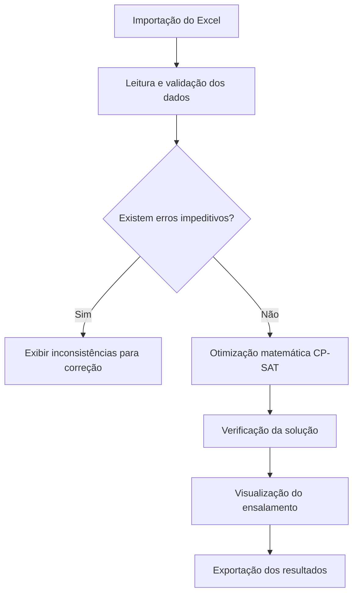

# 🥈 Sistema de Ensalamento | ABC Aprendiz

<p align="center">
  
</p>

<p align="center">
  <strong>2º lugar no Hackathon UniSoma 2026 | Equipe 12 · Grupo 22</strong>
</p>

<p align="center">
  Aplicativo desktop desenvolvido para automatizar a distribuição de estudantes entre turmas, utilizando otimização matemática e validação de dados.
</p>

## 🎯 Sobre o projeto

Como organizar estudantes em diferentes turmas, respeitando a disponibilidade de horários, os limites de vagas e o equilíbrio da distribuição, sem depender de um processo manual?

Esse foi o desafio apresentado pela **ABC Aprendiz** durante o Hackathon UniSoma 2026.

Nossa equipe desenvolveu uma solução capaz de transformar planilhas Excel em uma distribuição automatizada de estudantes, considerando as regras estabelecidas para cada turno e identificando inconsistências que poderiam comprometer o resultado.

O projeto foi construído durante um fim de semana de colaboração entre três participantes que não se conheciam anteriormente. Unindo conhecimentos em programação, modelagem matemática e tratamento de dados, entregamos um aplicativo funcional que conquistou o **2º lugar na competição**.

A versão apresentada neste repositório também incorpora melhorias realizadas após o hackathon, especialmente na validação dos dados, na apresentação dos resultados e nas opções de exportação.

## 💡 A solução desenvolvida

O sistema foi desenvolvido em **Python**, com interface gráfica em **PySide6** e otimização matemática utilizando **Google OR-Tools CP-SAT**.

A aplicação permite que os responsáveis pelo ensalamento importem uma planilha, verifiquem a qualidade dos dados e realizem a distribuição dos estudantes entre as turmas disponíveis.

### Principais funcionalidades

- **Importação de Excel:** leitura das abas `Alunos` e `Turmas` em um único arquivo.
- **Validação cadastral:** identificação de campos ausentes, informações inválidas e possíveis nomes duplicados.
- **Controle de vagas:** verificação da capacidade disponível em cada turno antes de iniciar a distribuição.
- **Prevenção de erros:** bloqueio do ensalamento quando existem dados obrigatórios incompletos ou vagas insuficientes.
- **Otimização matemática:** distribuição equilibrada dos estudantes, respeitando turnos, capacidades e proporções de gênero.
- **Visualização dos resultados:** consulta aos estudantes, turmas formadas e indicadores da distribuição.
- **Exportação:** geração de planilhas Excel com o ensalamento e as inconsistências, além de relatórios resumidos.

O objetivo não é apenas automatizar uma tarefa, mas garantir que a distribuição seja realizada a partir de informações consistentes e respeitando a capacidade real da instituição.

## 🖥️ Interface do sistema

A interface foi pensada para oferecer uma experiência simples e acessível, permitindo que os usuários acompanhem todo o processo sem precisar conhecer programação ou modelagem matemática.

### Tela inicial e importação



A partir da tela inicial, é possível selecionar a planilha Excel e visualizar os estudantes importados.



### Identificação de inconsistências



Antes da distribuição, o sistema verifica a integridade dos dados e informa os problemas encontrados. Os erros impeditivos devem ser corrigidos antes da execução, evitando resultados parciais ou inadequados.

### Ensalamento e distribuição



Com os dados validados, o solver matemático determina a composição das turmas, respeitando as restrições de cada turno.

### Resumo dos resultados



O painel permite conferir a ocupação, o número de estudantes e a composição de gênero das turmas.

### Exportação


Os resultados podem ser exportados para um novo arquivo Excel ou salvos no arquivo de entrada, mediante confirmação. O sistema também disponibiliza informações resumidas para conferência.

*As imagens demonstrativas utilizam dados fictícios, preservando a privacidade dos estudantes.*

## 🧠 Como funciona a otimização matemática?

O núcleo do sistema utiliza o **OR-Tools CP-SAT**, um solver de otimização baseado em programação por restrições.

O modelo matemático procura uma solução que respeite simultaneamente as condições estabelecidas.

**Restrições consideradas:**

1. Todos os estudantes com cadastro válido devem ser contemplados, desde que a planilha não apresente impedimentos.
2. Cada estudante deve ser alocado em exatamente uma turma.
3. O turno atribuído deve corresponder à disponibilidade informada.
4. Nenhuma turma pode ultrapassar sua capacidade máxima.
5. As turmas de um mesmo turno devem apresentar quantidades equilibradas de estudantes.

Além dessas restrições, a função objetivo busca **aproximar a proporção de gênero de cada turma à proporção real de estudantes daquele turno**, sem impor uma divisão artificial de 50% para cada gênero.

A implementação utiliza variáveis agregadas por turno e gênero. Após a otimização, os estudantes são associados às quantidades definidas pelo solver, preservando as restrições do problema.

O resultado é submetido a uma verificação independente antes de ser considerado válido.

O status `OPTIMAL` indica ótimo comprovado; `FEASIBLE` indica solução viável sem prova de otimalidade. `INFEASIBLE` significa inviabilidade, `MODEL_INVALID` indica modelo inválido e `UNKNOWN` significa encerramento sem solução comprovada. O limite padrão é 60 segundos. Somente soluções válidas e verificadas habilitam o salvamento.

Essa abordagem permite utilizar modelagem matemática para resolver o ensalamento, sem substituir a otimização por uma distribuição heurística manual.

## 🛠️ Tecnologias utilizadas

| Tecnologia | Aplicação |
|---|---|
| **Python 3.12.9** | Linguagem principal |
| **PySide6** | Interface gráfica desktop |
| **Google OR-Tools CP-SAT** | Modelagem e otimização matemática |
| **Pandas** | Manipulação e validação dos dados |
| **openpyxl** | Leitura e gravação de arquivos Excel |
| **PyInstaller** | Empacotamento para Windows |
| **unittest** | Testes automatizados |

## 🏗️ Arquitetura

O sistema foi organizado em módulos com responsabilidades distintas, facilitando a manutenção e a evolução da aplicação.

| Arquivo | Responsabilidade |
|---|---|
| `main.py` | Inicialização da aplicação |
| `gui.py` | Interface gráfica e interação com o usuário |
| `controller.py` | Validação, otimização matemática e exportação |
| `assets/` | Recursos visuais e imagens |
| `tests/` | Testes automatizados |

### Fluxo de funcionamento



## 📄 Estrutura da planilha

O sistema recebe um arquivo Excel contendo duas abas obrigatórias.

**Aba `Alunos`**

| Nome | Sexo | Disponibilidade |
|---|---|---|
| Ana Silva | Feminino | Manhã |
| Bruno Costa | Masculino | Manhã |
| Carla Souza | Feminino | Tarde |

**Aba `Turmas`**

| Recursos | Quantidade |
|---|---:|
| turmas_manha | 3 |
| turmas_tarde | 3 |
| vagas_manha | 30 |
| vagas_tarde | 35 |

Os valores representam a quantidade de turmas e a capacidade individual de cada turma por turno.

Por exemplo, três turmas pela manhã com 30 vagas cada oferecem capacidade para até 90 estudantes naquele período.

**Importante:** o sistema não cria vagas automaticamente. Caso a quantidade de estudantes ultrapasse a capacidade informada, o ensalamento é bloqueado até que os dados sejam revisados.

## 🚀 Como executar o projeto

### Pré-requisitos

- Windows.
- Python 3.12.9.
- Git, para clonar o repositório.

### 1. Clone o repositório

```bash
git clone https://github.com/KamillyFer-8/abc-aprendiz-ensalamento.git
cd abc-aprendiz-ensalamento
```

### 2. Crie um ambiente virtual

No PowerShell:

```powershell
python -m venv .venv
```

### 3. Instale as dependências

```powershell
.\.venv\Scripts\python.exe -m pip install -r requirements.txt
```

### 4. Execute a aplicação

```powershell
.\.venv\Scripts\python.exe main.py
```

A interface será iniciada, permitindo importar uma planilha e realizar o ensalamento.

### Executável para Windows

O sistema também pode ser distribuído como aplicativo Windows utilizando PyInstaller.

A configuração incluída e verificada utiliza o formato **onedir**. O arquivo `UniSoma.exe` precisa permanecer junto da pasta `_internal`.

```powershell
.\.venv\Scripts\python.exe -m pip install -r requirements-dev.txt
.\.venv\Scripts\python.exe -m PyInstaller main.spec --noconfirm
```

A saída fica em `dist/UniSoma-2026/UniSoma.exe`. Leve a pasta completa ao distribuir o aplicativo. O PyInstaller também oferece o formato `onefile`, mas ele não é o formato verificado deste pacote. Nenhum executável ou link de Release é incluído nesta publicação.

## 🧪 Testes e validação

O projeto contém testes automatizados para verificar a integridade dos dados, o funcionamento das restrições matemáticas e a geração dos resultados.

Entre os cenários abordados estão:

- Campos obrigatórios incompletos.
- Disponibilidade de turno inválida.
- Quantidade insuficiente de vagas.
- Possíveis nomes duplicados.
- Preservação dos estudantes no ensalamento.
- Restrições de capacidade e equilíbrio.
- Integridade dos arquivos exportados.

Para executar os testes:

```powershell
.\.venv\Scripts\python.exe -m unittest discover -s tests -v
```

Na preparação para publicação, 64 testes foram descobertos: 62 passaram e 2 foram ignorados por dependerem de planilhas privadas não distribuídas. Os testes usam `unittest`.

As verificações ajudam a assegurar que a aplicação não produza um ensalamento aparentemente válido quando existem problemas impeditivos nos dados.

## 🏆 Resultado e reconhecimento

**🥈 2º lugar no Hackathon UniSoma 2026**

Em um único fim de semana, nossa equipe transformou um desafio real em um aplicativo desktop funcional, integrando interface gráfica, tratamento de dados e otimização matemática.

Além do reconhecimento na competição, a experiência demonstrou a importância da colaboração, da comunicação e da aplicação de conhecimentos técnicos na resolução de problemas com impacto social.

O resultado foi uma solução que busca facilitar o trabalho dos voluntários da ABC Aprendiz, tornando o processo de ensalamento mais organizado, verificável e confiável.

## 👥 Equipe

Projeto desenvolvido colaborativamente pela **Equipe 12 | Grupo 22**:

- **Kamilly Ferreira Araújo**
- **Felipe Machado da Silva**
- **Debora Princepe**

Três participantes que não se conheciam antes do desafio e que, por meio da troca de conhecimentos e da complementaridade de habilidades, conseguiram desenvolver e entregar uma solução premiada.

Agradecemos à **UniSoma** pela oportunidade e à **ABC Aprendiz** por apresentar um desafio real que permitiu aplicar tecnologia a uma necessidade social.

## 📚 Documentação

O projeto conta com um manual ilustrado destinado aos usuários da aplicação.

📖 [Manual do Usuário](docs/Manual-do-Usuario-UniSoma-2026.pdf)

## Referências e licença

Agradecimentos à [UniSoma](https://unisoma.com.br/), organizadora do [Desafio UniSoma 2026](https://unisoma.com.br/desafio/), e à [ABC Aprendiz](https://www.abcaprendiz.org.br/). Acompanhe a [UniSoma no LinkedIn](https://www.linkedin.com/company/unisoma/).

O [regulamento oficial](https://unisoma.com.br/desafio/regulamento-2026/) orienta o uso dos dados e as referências institucionais. As autorizações para publicar o código e utilizar os materiais institucionais foram confirmadas pela responsável. **Direitos reservados — autorização prévia necessária.** Para utilizar o aplicativo, modificar, redistribuir ou comercializar o código autoral, solicite autorização expressa, por escrito, dos três integrantes da equipe. Consulte os [termos de uso e direitos reservados](LICENSE.md), que preservam permissões anteriores, direitos de terceiros e as regras do GitHub para repositórios públicos.

## 📌 Observações

- O sistema foi desenvolvido para uso com planilhas Excel estruturadas conforme o modelo esperado.
- Cadastros incompletos e configurações inválidas impedem a execução do ensalamento.
- Possíveis nomes duplicados são sinalizados para conferência, sem exclusão automática.
- Os dados reais dos estudantes não são disponibilizados neste repositório.
- O código e os materiais institucionais estão sujeitos às permissões de uso e redistribuição dos respectivos responsáveis.

---

<p align="center">
  <strong>Desenvolvido durante o Hackathon UniSoma 2026 💚</strong>
</p>

<p align="center">
  Tecnologia, colaboração e otimização matemática aplicadas a um problema real.
</p>
